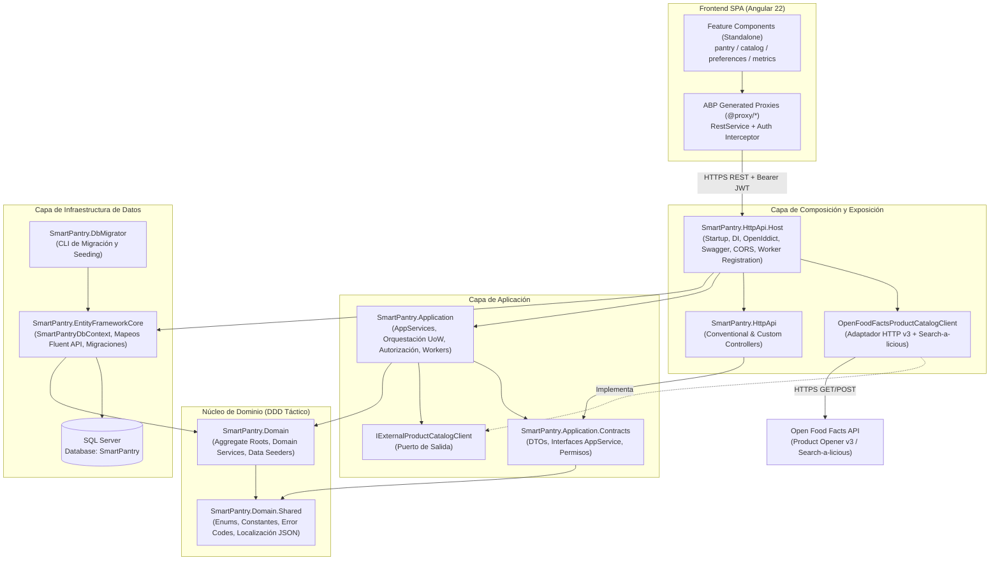

# 01. Arquitectura de Software y Stack Tecnológico — SmartPantry

> **Propósito de este documento:** Definir el patrón arquitectónico, la dirección estricta de dependencias, el inventario exacto de versiones de runtime/frameworks/librerías y la responsabilidad de cada capa del repositorio. Todo desarrollo nuevo debe respetar esta topología sin introducir dependencias cruzadas ni librerías redundantes.

---

## 1. Patrón Arquitectónico

### 1.1 Definición: Monolito en Capas con DDD Táctico e Inversión de Dependencias
SmartPantry implementa la arquitectura **ABP Layered Monolith** combinada con principios de **Domain-Driven Design (DDD) Táctico** e **Inversión de Dependencias (Ports & Adapters / Clean Architecture)** para integraciones externas y persistencia:

1. **Separación entre flujo de ejecución y grafo de compilación:** Aunque en tiempo de ejecución una petición fluye desde Angular hacia `HttpApi.Host` -> `Application` -> `Domain` -> `EntityFrameworkCore` -> `SQL Server`, en tiempo de compilación el núcleo de negocio (`SmartPantry.Domain` y `SmartPantry.Domain.Shared`) **no depende de EF Core, ASP.NET Core, HTTP ni JSON**.
2. **Desacoplamiento de proveedores externos (Puerto y Adaptador):** La capa de aplicación define la abstracción propia (`IExternalProductCatalogClient` en `SmartPantry.Application`), mientras que la implementación concreta (`OpenFoodFactsProductCatalogClient`) reside en la capa de infraestructura/host (`SmartPantry.HttpApi.Host`) inyectando `HttpClient` administrado por `IHttpClientFactory`.
3. **Exposición HTTP automática (Auto API Controllers):** Los casos de uso implementados en clases `ApplicationService` dentro de `SmartPantry.Application` se exponen automáticamente como endpoints REST bajo `/api/app/*` mediante la convención de controladores dinámicos de ABP (`ConfigureConventionalControllers`), eliminando controladores manuales redundantes.
4. **Cliente SPA fuertemente tipado:** La aplicación Angular consume exclusivamente la API propia de SmartPantry a través de servicios proxy generados automáticamente (`@proxy/*`) sobre `RestService` de `@abp/ng.core`. **Angular jamás invoca directamente a Open Food Facts.**

### 1.2 Diagrama de Dependencias entre Capas y Módulos

### 1.3 Justificación Arquitectónica
- **Cohesión académica y productiva:** Satisface los requerimientos no funcionales de aislamiento de dominio sin incurrir en la complejidad operativa innecesaria de microservicios, colas distribuidas o múltiples bases de datos.
- **Testabilidad determinista sin red:** Al ubicar `IExternalProductCatalogClient` detrás de una interfaz propia e inyectar repositorios de ABP, toda la lógica de negocio y aplicación se verifica en milisegundos mediante mocks (`NSubstitute`) y SQLite en memoria, garantizando ejecuciones de CI 100% reproducibles sin conexión a Internet.
- **Transaccionalidad automática (`UnitOfWork`):** Cada método de un `ApplicationService` y cada ciclo de `ExpirationWarningWorker` se ejecuta dentro de una unidad de trabajo transaccional gestionada por ABP, asegurando consistencia atómica entre entidades e índices únicos.

---

## 2. Stack Tecnológico Detallado

Las versiones indicadas corresponden a la configuración activa verificada en `SmartPantry.slnx`, los archivos `.csproj` y `angular/package.json`:

### 2.1 Lenguajes y Runtimes
| Componente | Tecnología | Versión Exacta | Notas de Configuración |
|---|---|---|---|
| **Backend Runtime** | .NET SDK / ASP.NET Core Runtime | `net10.0` (.NET 10) | `<Nullable>enable</Nullable>` activo en todos los proyectos `.csproj`. |
| **Lenguaje Backend** | C# | `C# 14` (ligado a `net10.0`) | Constructores primarios/de dominio, tipos por referencia anulables explícitos. |
| **Frontend Runtime (Build/Dev)** | Node.js + Yarn Classic | `Node.js >= 24.15.0 LTS` / `Yarn 1.22.x` | Requerido para Angular CLI 22 y paquetes `@abp/*`. |
| **Lenguaje Frontend** | TypeScript | `~6.0.3` | Tipado estricto sobre Angular Signals y formularios reactivos. |

### 2.2 Frameworks Core (Backend y Frontend)
| Capa | Framework / Plataforma | Versión Exacta | Rol en el Sistema |
|---|---|---|---|
| **Plataforma Full-Stack** | ABP Framework (Open Source Layered) | `10.6.0` | Modularidad, DDD building blocks, UoW, Auto API Controllers, Multi-idioma, Settings y Permisos. |
| **Seguridad / OIDC** | OpenIddict (`Volo.Abp.OpenIddict.*`) | `10.6.0` | Servidor OAuth 2.0 / OpenID Connect integrado y validación de Bearer JWT. |
| **Contenedor IoC** | Autofac (`Volo.Abp.Autofac`) | `10.6.0` | Inyección de dependencias avanzada e interceptores dinámicos (autorización, auditoría, validación). |
| **Frontend SPA** | Angular (`@angular/core`, `@angular/router`, `@angular/forms`) | `~22.0.2` | Arquitectura basada en *Standalone Components*, Signals (`signal`, `computed`), `@switch`/`@for` control flow y Lazy Loading. |
| **UI Theme & Componentes** | ABP LeptonX Lite (`@abp/ng.theme.lepton-x`) + Bootstrap 5 / NgBootstrap | `~5.6.0` / `@abp/ng.* ~10.6.0` | Layout responsivo tabla/tarjetas, modales (`abp-modal`), confirmaciones (`ConfirmationService`) y paginación (`ngb-pagination`). |
| **Programación Reactiva UI** | RxJS | `~7.8.0` | Flujos asíncronos HTTP con `RestService` y paginación reactiva con `ListService`. |

### 2.3 Persistencia y Procesamiento en Segundo Plano
| Componente | Tecnología | Versión / Motor | Uso Específico |
|---|---|---|---|
| **Motor Relacional Principal** | Microsoft SQL Server (Developer / Express / LocalDB) | SQL Server 2019/2022 / LocalDB | Base de datos transaccional (`Database=SmartPantry`). |
| **ORM** | Entity Framework Core (`Volo.Abp.EntityFrameworkCore.SqlServer`) | `10.6.0` (EF Core 10) | Mapeo relacional Fluent API, migraciones versionadas e índices únicos. |
| **Almacenamiento Binario** | ABP Blob Storing Database (`Volo.Abp.BlobStoring.Database.*`) | `10.6.0` | Almacenamiento en tabla `AbpBlobs` disponible para foto opcional de perfil (RF-02). |
| **Background Processing** | ABP Background Workers (`Volo.Abp.BackgroundWorkers`) | `10.6.0` | Ejecución periódica en proceso mediante `AbpAsyncTimer` para `ExpirationWarningWorker` (cada 12 h). |

### 2.4 Librerías Críticas de Mapeo, Observabilidad y Calidad
| Categoría | Librería / Herramienta | Versión | Propósito |
|---|---|---|---|
| **Object Mapping** | Mapperly (`Volo.Abp.Mapperly`) + Proyección explícita | `10.6.0` | Generación de mapeadores en tiempo de compilación sin costo de reflexión (`SmartPantryApplicationMappers.cs`). |
| **Logging Estructurado** | Serilog (`Volo.Abp.AspNetCore.Serilog`) | `10.6.0` | Escritura asíncrona en consola y archivo rotativo (`Logs/logs.txt`) enriquecida con correlación HTTP. |
| **Documentación API** | Swashbuckle OpenAPI (`Volo.Abp.Swashbuckle`) | `10.6.0` | Especificación `/swagger/v1/swagger.json` con soporte interactivo OAuth2 (`SmartPantry_Swagger`) y Bearer JWT. |
| **Testing Backend** | xUnit + Shouldly + NSubstitute + EF Core SQLite | `2.9.3` / `4.3.0` / `5.3.0` | Pruebas unitarias de reglas/servicios con mocks y pruebas de integración contra SQLite In-Memory. |
| **Cobertura Backend** | Microsoft Code Coverage (`CodeCoverage.runsettings`) | SDK `17.14.1` | Recolección en formato Cobertura XML filtrando exclusivamente `Domain` y `Application` ($\ge 70\%$ de líneas). |
| **Testing Frontend** | Vitest + jsdom | `^4.0.0` / `^27.1.0` | Pruebas unitarias rápidas de componentes standalone Angular simulando proxies de ABP. |

---

## 3. Diseño de Capas y Modularización del Código Fuente

La solución se organiza físicamente en proyectos `.NET` bajo `src/` y `test/`, más la SPA bajo `angular/`:

### 3.1 Proyectos Backend (`src/`)

| Proyecto / Directorio | Responsabilidad Estricta | Elementos Permitidos | Elementos Prohibidos |
|---|---|---|---|
| `src/SmartPantry.Domain.Shared` | Vocabulario estático compartido entre todas las capas (incluido clientes externos). | Enumeraciones (`ItemCategory`, `PantryItemState`, `DietaryVerificationStatus`), constantes de longitud (`ProductConsts`, `PantryConsts`, `PantryWarningConsts`, `PreferenceConsts`), códigos de error y archivos de localización (`es.json`, `en.json`). | Entidades con comportamiento, lógica de base de datos, dependencias HTTP o DTOs mutables. |
| `src/SmartPantry.Domain` | Corazón de las reglas de negocio, invariantes y consistencia transaccional. | `AggregateRoot` / `Entity` con setters privados y métodos de dominio (`Product`, `PantryItem`, `PantryItemWarning`, `UserDietaryPreference`, `ExternalApiCallLog`), `DomainService` (`PantryExpirationManager`, `DietaryWarningManager`), `IDataSeedContributor` y definiciones de `Settings`. | Atributos `[Authorize]`, DTOs de presentación, referencias a `DbContext`, `HttpClient` o serializadores JSON de APIs de terceros. |
| `src/SmartPantry.Application.Contracts` | Contratos públicos de casos de uso y modelo de permisos. | Interfaces `I*AppService` (`IPantryAppService`, `IProductAppService`, `IExternalProductCatalogAppService`, `IDietaryPreferenceAppService`, `IIntegrationMetricsAppService`), clases `*Dto` con DataAnnotations y `SmartPantryPermissions`. | Implementaciones de servicios, consultas LINQ a repositorios o entidades del dominio expuestas directamente en firmas públicas. |
| `src/SmartPantry.Application` | Coordinación de casos de uso, seguridad imperativa/declarativa y workers de aplicación. | Clases `*AppService`, `[Authorize]`, validación de propiedad vía `ICurrentUser`, puerto `IExternalProductCatalogClient`, excepciones de integración y `ExpirationWarningWorker`. | Instanciación manual de `new HttpClient()`, consultas SQL crudas acopladas a SQL Server o lógica compleja de invariantes fuera del dominio. |
| `src/SmartPantry.EntityFrameworkCore` | Mapeo objeto-relacional y evolución versionada del esquema SQL Server. | `SmartPantryDbContext`, configuración Fluent API (`ToTable`, `HasMaxLength`, `HasIndex().IsUnique()`, FKs) y clases en `Migrations/`. | Reglas de negocio, cálculos de vencimientos o llamadas a servicios externos. |
| `src/SmartPantry.HttpApi` | Punto de extensión para controladores HTTP explícitos cuando un caso puntual (p. ej. descarga binaria) lo requiera. | `SmartPantryController` base. El 95%+ de los endpoints se generan vía Auto API Controllers desde `Application`. | Lógica de aplicación o acceso directo a `DbContext`. |
| `src/SmartPantry.HttpApi.Host` | Raíz de composición (*Composition Root*), servidor web Kestrel/IIS y adaptadores HTTP salientes. | `Program.cs`, `SmartPantryHttpApiHostModule`, configuración OpenIddict/Swagger/CORS, registro `AddHttpClient<IExternalProductCatalogClient, OpenFoodFactsProductCatalogClient>()`, DTOs internos de deserialización JSON de Open Food Facts y arranque del worker. | Reglas de dominio de despensa o preferencias. |
| `src/SmartPantry.DbMigrator` | Ejecutable de consola idempotente para inicializar esquema y semillas. | Aplicación de migraciones EF Core pendientes y ejecución ordenada de `IDataSeedContributor` (roles, clientes OpenIddict, usuarios de prueba y semillas iniciales). | Exposición de puertos HTTP. |

### 3.2 Modularización Frontend (`angular/src/app/`)

| Ruta / Módulo | Responsabilidad Técnica |
|---|---|
| `app.routes.ts` & `route.provider.ts` | Definición de rutas con *lazy loading* (`loadComponent`), protección con `authGuard` / `permissionGuard` y registro declarativo de entradas del menú lateral localizado (`::Menu:*`). |
| `proxy/` | **Código autogenerado (`abp generate-proxy -t ng`)**. Contiene los servicios `RestService` tipados y las interfaces TypeScript espejadas desde el backend. **Prohibido editar manualmente sus archivos.** |
| `pantry/` | Módulo standalone **"Mi despensa"** (RF-10, RF-11, RF-13, RF-14): grilla responsiva (tabla desktop / tarjetas mobile), badges de vencimiento y advertencias, modal de creación/edición con nota privada, consumo y baja confirmada. |
| `catalog/` | Módulo standalone **"Catálogo de Productos"** (RF-05, RF-06, RF-07, RF-08, RF-09, RF-12): búsqueda dual (código de barras y texto libre paginado), modal/vista de detalle nutricional con Nutri-Score y NOVA, banner de advertencia alimentaria + aviso ético, acción de guardado interno y alta directa en despensa. |
| `preferences/` | Módulo standalone **"Preferencias Alimentarias"** (RF-03, RF-12): gestión de etiquetas de alérgenos/ingredientes vigilados (`watchedTerms`) y switch `showAlertsOnScreen`. |
| `admin/integration-metrics/` | Módulo standalone **"Métricas de Integración"** (HU-05): tablero exclusivo para administradores (`SmartPantry.IntegrationMetrics.Default`) con totales de consultas externas, tasa de error, excesos de cuota (`429`) y latencia promedio/máxima. |
| `shared/components/medical-disclaimer/` | Banner reutilizable de aviso ético y origen de datos Open Food Facts (Regla de Negocio 1 y RNF Ética). |

### 3.3 Proyectos de Pruebas Automatizadas (`test/`)

| Proyecto | Alcance de Verificación |
|---|---|
| `test/SmartPantry.Domain.Tests` | Pruebas unitarias puras de invariantes en `Product`, `PantryItem`, `UserDietaryPreference`, `DietaryWarningManager` y reloj controlado en `PantryExpirationManager`. |
| `test/SmartPantry.Application.Tests` | Pruebas de casos de uso (`PantryAppService`, `ProductAppService`, `ExternalProductCatalogAppService` con mock `NSubstitute` de `IExternalProductCatalogClient`, `DietaryPreferenceAppService`, `IntegrationMetricsAppService`), verificando aislamiento entre usuarios (`FakeCurrentPrincipalAccessor`). |
| `test/SmartPantry.EntityFrameworkCore.Tests` | Pruebas de integración reales contra motor relacional SQLite en memoria verificando mapeos EF Core, restricciones `UNIQUE` (`Barcode`, `PantryItemId + WarningType`, `UserId`), transacciones UoW y persistencia efectiva. |
