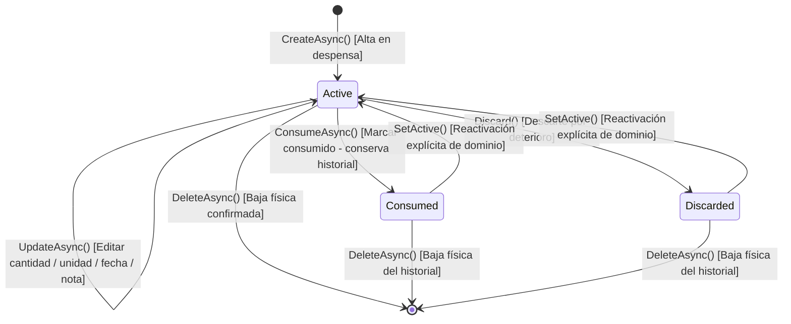
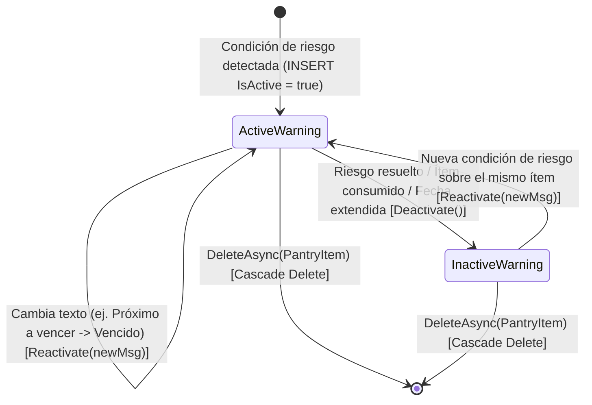

# 03. Reglas de Negocio, Máquinas de Estados y Flujos Críticos — SmartPantry

> **Propósito de este documento:** Formalizar las reglas de negocio inmutables, las máquinas de estados de las entidades del dominio y la secuencia algorítmica exacta de los flujos críticos de valor. Ningún controlador, servicio o pantalla de interfaz puede contradecir estas reglas.

---

## 1. Catálogo de Reglas de Negocio Inmutables (`BR-001` a `BR-010`)

### `BR-001` — Naturaleza Informativa y Aviso Ético No Médico
- **Requerimientos asociados:** Regla de Negocio 1, RNF Ética y Datos, RF-12.
- **Precondiciones:** Renderizado de cualquier pantalla de preferencias (`/preferences`), catálogo/detalle de producto (`/catalog`) o despensa con advertencias (`/pantry`).
- **Regla Inmutable:** Ninguna coincidencia de ingredientes/alérgenos ni alerta del sistema equivale a un diagnóstico clínico, recomendación nutricional o aval de inocuidad. La interfaz debe exhibir de forma visible la leyenda localizada de limitación médica y atribuir explícitamente los datos públicos de catálogo a **Open Food Facts** (bajo licencia ODbL).
- **Efectos colaterales:** El sistema utiliza vocabulario estrictamente informativo (`"Advertencia informativa"`, `"Coincidencia detectada"`, `"No verificable"`) y prohíbe emplear términos clínicos (`"Seguro para celíacos"`, `"Apto consumo médico"`, `"Prohibido ingerir"`).

### `BR-002` — Datos Ausentes Equivalen a No Verificable (Prohibición de Asumir Ausencia de Riesgo)
- **Requerimientos asociados:** Regla de Negocio 2, RF-09, RF-12.
- **Precondiciones:** Usuario autenticado con `ShowAlertsOnScreen == true` y al menos un término configurado en `WatchedTerms`, evaluando un `ExternalProductDto` o un `Product` interno.
- **Regla Inmutable:**
  1. Si `WatchedTerms` está vacío o `ShowAlertsOnScreen == false`, el estado resultante es `DietaryVerificationStatus.NotConfigured`.
  2. Si algún término vigilado coincide (normalizado sin tildes y case-insensitive) con el texto de `Allergens` o `Ingredients` disponibles, el estado es **inmediatamente** `DietaryVerificationStatus.Warning` (incluso si uno de los dos campos falta, basta con detectar presencia positiva en el campo presente).
  3. Si **no hay coincidencias detectadas**, pero `Ingredients` es `null`/vacío **O** `Allergens` es `null`/vacío, el estado resultante **DEBE** ser `DietaryVerificationStatus.Unverifiable`. Está taxativamente prohibido devolver `Compatible` cuando falta información de composición o alérgenos.
  4. Solo cuando tanto `Ingredients` como `Allergens` están informados no vacíos y ningún término vigilado coincide, se retorna `DietaryVerificationStatus.Compatible`.
- **Efectos colaterales:** En la interfaz gráfica, toda propiedad nula del proveedor (`Brand`, `Quantity`, `Ingredients`, `Allergens`, `NutriScore`, `NovaGroup`, `ImageUrl`) se comunica explícitamente como `"No especificado"` / `"No informado por Open Food Facts"`, sin rellenar ceros, guiones engañosos ni valores sintéticos.

### `BR-003` — Aislamiento Estricto por Propietario (Prevención de IDOR)
- **Requerimientos asociados:** Regla de Negocio 3, RF-03, RF-10, RF-11, RF-14.
- **Precondiciones:** Cualquier operación sobre `AppPantryItems`, `AppPantryItemWarnings` o `AppUserDietaryPreferences`.
- **Regla Inmutable:** La identidad del propietario se obtiene exclusivamente en el servidor mediante `CurrentUser.GetId()` extraído del token JWT validado (jamás confiando en un `userId` enviado en el body o query por el cliente).
  - En listados (`GetListAsync`), la consulta LINQ aplica obligatoriamente `.Where(x => x.UserId == currentUserId)`.
  - En operaciones puntuales (`GetAsync`, `UpdateAsync`, `ConsumeAsync`, `DeleteAsync`), si el registro existe pero `item.UserId != currentUserId`, el servicio lanza `AbpAuthorizationException`, respondiendo **HTTP 403 Forbidden** sin filtrar ni mutar ningún dato del ítem ajeno.
- **Efectos colaterales:** Ni siquiera un usuario con rol `admin` lee o altera despensas privadas ajenas a través de `PantryAppService`; la administración de `admin` se circunscribe a cuentas de identidad y métricas agregadas de integración.

### `BR-004` — Unicidad e Idempotencia del Catálogo Interno por Código de Barras
- **Requerimientos asociados:** Regla de Negocio 4, RF-08.
- **Precondiciones:** Solicitud de guardado interno de un producto (`CreateAsync` o `SaveFromExternalAsync`).
- **Regla Inmutable:** `Barcode` es obligatorio (`1..32` caracteres tras `.Trim()`) e identifica de manera única cada fila en `AppProducts` mediante el índice `IX_AppProducts_Barcode (UNIQUE)`.
  - En `SaveFromExternalAsync`: si ya existe un `Product` con el mismo `Barcode` normalizado, el servicio actualiza sus metadatos informativos opcionales si estaban ausentes y devuelve el `ProductDto` existente sin lanzar error ni duplicar el registro.
  - En `CreateAsync` directo: si se intenta dar de alta manualmente un `Barcode` ya registrado, se rechaza con excepción de negocio controlada (`SmartPantry:Product:DuplicateBarcode`, HTTP 409/403 según mapeo ABP).
- **Efectos colaterales:** Todos los `PantryItem` de distintos usuarios que agregan ese código de barras apuntan al mismo `ProductId`.

### `BR-005` — Registro Sanitizado de Métricas de Integración Externa
- **Requerimientos asociados:** Regla de Negocio 5, HU-05, RNF Observabilidad.
- **Precondiciones:** Ejecución de cualquier petición HTTP saliente en `OpenFoodFactsProductCatalogClient` (`GetByBarcodeAsync` o `SearchByTextAsync`).
- **Regla Inmutable:** Cada invocación externa mide su tiempo de respuesta con `Stopwatch` y registra en `AppExternalApiCallLogs` (en una transacción independiente `RequiresNew` para persistir incluso si la llamada falla): `OperationType`, `OutcomeStatus`, `HttpStatusCode`, `DurationMs` y `QueryTermLength`. **Queda estrictamente prohibido** persistir encabezados `Authorization`, cookies de usuario o el JSON completo devuelto por Open Food Facts en la base de datos o en `Logs/logs.txt`.
- **Efectos colaterales:** Alimenta en tiempo real el panel administrativo de salud e integración (`IIntegrationMetricsAppService`).

### `BR-006` — Conservación de Ítems Consumidos vs Eliminación Explícita
- **Requerimientos asociados:** Regla de Negocio 6, RF-11.
- **Precondiciones:** Ítem existente en `AppPantryItems` perteneciente al usuario actual.
- **Regla Inmutable:** Invocar `ConsumeAsync(id)` **no elimina** la fila de `AppPantryItems`: ejecuta `item.Consume()`, cambiando `State` a `PantryItemState.Consumed (1)`. El registro permanece en la base de datos como historial y se muestra con badge diferenciado en la grilla. Solo la operación explícita `DeleteAsync(id)`, precedida en frontend por confirmación modal del usuario, remueve físicamente el registro y sus advertencias asociadas.
- **Efectos colaterales:** Al pasar a `Consumed`, cualquier advertencia activa de vencimiento sobre ese ítem se desactiva (`IsActive = false`) de inmediato o en el siguiente ciclo de `PantryExpirationManager`.

### `BR-007` — Cálculo Determinista de Vencimientos por Categoría y Calendario Argentino
- **Requerimientos asociados:** RF-13, RF-15.
- **Precondiciones:** Evaluación de `ExpirationDate` en `PantryExpirationManager` y proyección de estado en `PantryAppService`.
- **Regla Inmutable:**
  1. Toda fecha de vencimiento se normaliza como fecha civil sin hora (`ExpirationDate.Value.Date`).
  2. La fecha actual de referencia (`today`) se obtiene convirtiendo `DateTime.UtcNow` al huso horario `America/Argentina/Buenos_Aires` (fallback Windows: `Argentina Standard Time`) y truncando `.Date`.
  3. El umbral `threshold` en días depende exclusivamente de `Product.Category` (`ItemCategory`):
     - `Dairy` o `MeatAndFish`: **2 días**.
     - `Bakery` o `FruitsAndVegetables`: **3 días**.
     - `DryGoods` o `CannedGoods`: **7 días**.
     - Resto de categorías (`Beverages`, `Snacks`, `Condiments`, `Frozen`, `Cleaning`, `Other`, `Undefined`): **3 días** (`PantryWarningConsts.DefaultThresholdDays`).
  4. Clasificación temporal (solo aplicable si `item.State == PantryItemState.Active` y `item.ExpirationDate != null`):
     - `expDate < today`: **Vencido** -> Mensaje `"Vencido el {dd/MM/yyyy}"`.
     - `today <= expDate <= today.AddDays(threshold)`: **Próximo a vencer** -> Mensaje `"Próximo a vencer el {dd/MM/yyyy}"`.
     - `expDate > today.AddDays(threshold)`: **Vigente fuera de umbral** -> Sin advertencia activa.
- **Efectos colaterales:** Al editar `UpdateAsync` la fecha de vencimiento de un ítem o consumirlo (`ConsumeAsync`), `PantryAppService` sincroniza la advertencia del ítem en la misma transacción para reflejar el cambio instantáneamente en la interfaz sin esperar 12 horas al próximo ciclo del worker.

### `BR-008` — Ejecución Autónoma e Idempotente del Worker de Vencimientos
- **Requerimientos asociados:** RF-15.
- **Precondiciones:** Arranque de `SmartPantry.HttpApi.Host` (`RunOnStart = true`) y disparo periódico cada `43.200.000 ms` (12 horas).
- **Regla Inmutable:** `ExpirationWarningWorker` opera mediante `IServiceScopeFactory` e `IUnitOfWorkManager` (`IsTransactional = true`) sin requerir usuario autenticado (`ICurrentUser.IsAuthenticated == false`) ni conexión a Internet. Ejecutar `ProcessExpirationsAsync` $N$ veces consecutivas con los mismos datos produce exactamente el mismo estado en `AppPantryItemWarnings`:
  - Si no existe fila `(PantryItemId, "Expiration")` y corresponde alerta -> `INSERT` (`IsActive = true`).
  - Si existe fila inactiva o con `Message` distinto y corresponde alerta -> `UPDATE` (`Reactivate(message)` -> `IsActive = true`).
  - Si existe fila activa y el ítem ya no aplica (fue consumido, se quitó su fecha o se extendió más allá del umbral) -> `UPDATE` (`Deactivate()` -> `IsActive = false`).
- **Efectos colaterales:** Fallas transitorias dentro del worker se capturan y registran con `Logger.LogError` sin detener el temporizador `AbpAsyncTimer`.

### `BR-009` — Validación de Invariantes en Dominio para Cantidades, Unidades, Fechas y Notas
- **Requerimientos asociados:** RF-08, RF-10, RF-11, RF-14.
- **Precondiciones:** Construcción o mutación de `Product`, `PantryItem` y `UserDietaryPreference`.
- **Regla Inmutable:**
  - `PantryItem.Quantity`: opcional (`null`), pero si tiene valor debe cumplir `Quantity >= 0` (lanza `BusinessException("SmartPantry:PantryItem:NegativeQuantity")`).
  - `PantryItem.Unit`: opcional (`null`), normalizada con `.Trim()`; cadenas en blanco se convierten en `null`; longitud máxima `32` caracteres (`SmartPantry:PantryItem:UnitTooLong`).
  - `PantryItem.PrivateNotes`: opcional (`null`), normalizada con `.Trim()`; cadenas en blanco se convierten en `null`; longitud máxima `500` caracteres (`SmartPantry:PantryItem:NotesTooLong`).
  - `PantryItem.ExpirationDate`: opcional (`null`); si se informa, debe ser una fecha civil válida entre `1900-01-01` y `2100-12-31` (`SmartPantry:PantryItem:InvalidExpirationDate`).
  - `Product.Category`: debe ser un valor definido de `ItemCategory` distinto de `ItemCategory.Undefined (0)`.
- **Efectos colaterales:** Las invariantes se protegen en el constructor y métodos `Set*` del dominio, impidiendo estados corruptos incluso si se invoca la entidad fuera de los DTOs HTTP.

### `BR-010` — Persistencia de Advertencia Alimentaria al Incorporar a Despensa
- **Requerimientos asociados:** RF-12, HU-04.
- **Precondiciones:** Ejecución de `PantryAppService.CreateAsync` o cambio de preferencias del usuario en `DietaryPreferenceAppService.UpdateMyPreferencesAsync`.
- **Regla Inmutable:** Al agregar un `PantryItem`, `DietaryWarningManager` evalúa el `Product` asociado contra las `UserDietaryPreference` del usuario:
  - Si el estado es `Warning` o `Unverifiable`, persiste (o reactiva) una fila en `AppPantryItemWarnings` con `WarningType = "DietaryPreference"` e `IsActive = true` detallando los términos coincidentes o el carácter no verificable.
  - Si el estado es `Compatible` o `NotConfigured`, desactiva cualquier `PantryItemWarning` previa de tipo `"DietaryPreference"` para ese ítem.
- **Efectos colaterales:** Cuando el usuario modifica sus `WatchedTerms` en `/preferences`, el servicio recalcula de manera idempotente las advertencias `"DietaryPreference"` de sus ítems de despensa activos.

---

## 2. Máquinas de Estados de Entidades Críticas

### 2.1 Máquina de Estados de `PantryItem` (`PantryItemState`)



#### Matriz de Transiciones de `PantryItem`
| Estado Origen | Evento / Operación | Estado Destino | Permitido | Regla Aplicada |
|---|---|---|---|---|
| `(Inexistente)` | `CreateAsync` | `Active (0)` | Sí | Todo ítem ingresa activo al inventario del usuario. |
| `Active (0)` | `UpdateAsync` | `Active (0)` | Sí | Permite actualizar `Quantity`, `Unit`, `ExpirationDate` y `PrivateNotes`, recalculando alerta de vencimiento. |
| `Active (0)` | `ConsumeAsync` | `Consumed (1)` | Sí | Regla `BR-006`: preserva fila histórica y desactiva alertas activas de vencimiento. |
| `Consumed (1)` | `ConsumeAsync` | `Consumed (1)` | Idempotente (No-op en dominio, botón oculto en UI) | No genera duplicados ni errores si se invoca repetidamente. |
| `Consumed (1)` | `Edit (UI Modal)` | — | Bloqueado en UI | Según decisión técnica TP10, los ítems consumidos representan historial cerrado en la grilla; solo admiten visualización o baja definitiva `DeleteAsync`. |
| `Cualquiera` | `DeleteAsync` | `(Eliminado físicamente)` | Sí (solo propietario) | Requiere confirmación en cliente y validación `GetOwnedItemAsync` en backend. |

---

### 2.2 Máquina de Estados de `PantryItemWarning` (`IsActive`)



---

## 3. Flujos Críticos del Sistema

### 3.1 Flujo Principal de Valor: Búsqueda Externa -> Evaluación Alimentaria -> Guardado -> Alta en Despensa

```mermaid
sequenceDiagram
    autonumber
    actor U as Usuario Autenticado (Angular)
    participant CatApp as ExternalProductCatalogAppService
    participant DietMgr as DietaryWarningManager
    participant OffClient as OpenFoodFactsProductCatalogClient
    participant OFF as Open Food Facts API
    participant ProdApp as ProductAppService
    participant PanApp as PantryAppService
    participant DB as SQL Server (SmartPantry)

    U->>CatApp: GET /api/app/external-product-catalog/search?query=galletitas
    CatApp->>OffClient: SearchByTextAsync(query, skipCount, maxResultCount)
    OffClient->>OFF: POST https://search.openfoodfacts.org/search
    OFF-->>OffClient: 200 OK (hits JSON)
    OffClient->>DB: INSERT AppExternalApiCallLogs (TextSearch, Found, durationMs)
    OffClient-->>CatApp: ExternalProductSearchResultDto
    CatApp->>DB: SELECT AppUserDietaryPreferences WHERE UserId = CurrentUser.Id
    CatApp->>DietMgr: Evaluate(externalProducts, userPreferences)
    DietMgr-->>CatApp: DietaryEvaluationDto (Compatible / Warning / Unverifiable)
    CatApp-->>U: Resultados paginados + Alertas informativas + Origen OFF

    U->>ProdApp: POST /api/app/product/save-from-external (ExternalProductDto + Category)
    ProdApp->>DB: SELECT AppProducts WHERE Barcode = input.Barcode
    alt Producto no existe aún en AppProducts
        ProdApp->>DB: INSERT AppProducts (Unique Barcode)
    else Producto ya existe por Barcode
        ProdApp->>DB: Completa campos ausentes y reutiliza Product.Id
    end
    ProdApp-->>U: 200 OK (ProductDto con Id interno)

    U->>PanApp: POST /api/app/pantry (productId, quantity, unit, expirationDate, privateNotes)
    PanApp->>DB: INSERT AppPantryItems (UserId = CurrentUser.Id, State = Active)
    PanApp->>DietMgr: SyncItemDietaryWarningAsync(pantryItem, product, userPreferences)
    PanApp->>DB: Upsert AppPantryItemWarnings (Expiration & DietaryPreference si aplican)
    PanApp-->>U: 200 OK (PantryItemDto con activeWarnings)
```

#### Secuencia Algorítmica Paso a Paso
1. **Consulta autenticada:** El usuario ingresa un código EAN/GTIN (RF-05) o un término de texto libre (RF-06) en `/catalog`. Angular envía la solicitud con el JWT Bearer mediante el proxy generado.
2. **Traducción y telemetría:** `OpenFoodFactsProductCatalogClient` consulta Product Opener v3 (`GET`) o Search-a-licious (`POST`), mide la duración exacta, persiste `ExternalApiCallLog` (`BR-005`) y transforma la respuesta a `ExternalProductDto` preservando `null` en cualquier dato no informado (`BR-002`).
3. **Evaluación de preferencias en tiempo de lectura:** `ExternalProductCatalogAppService` recupera `UserDietaryPreference` del usuario actual e invoca `DietaryWarningManager.Evaluate(...)`, adjuntando a cada producto su `DietaryVerificationStatus`, la lista de `matchedTerms` y el mensaje informativo correspondiente (RF-12).
4. **Inspección de detalle:** El usuario abre el detalle del producto (RF-07), visualizando imagen, marca, ingredientes, alérgenos, Nutri-Score, NOVA, campos `"No especificado"` (RF-09), banner de evaluación alimentaria y leyenda obligatoria de no consejo médico (`BR-001`).
5. **Persistencia idempotente en catálogo propio:** Al pulsar *"Guardar / Agregar a mi despensa"*, Angular invoca `POST /api/app/product/save-from-external` indicando la categoría interna (`ItemCategory`). El backend garantiza unicidad por `Barcode` (`BR-004`) y retorna el `ProductDto` persistido (RF-08).
6. **Alta privada en despensa:** Con el `productId` interno, el usuario completa cantidad, unidad, fecha de vencimiento y nota privada opcionales en el modal y ejecuta `POST /api/app/pantry` (RF-10, RF-14). El backend asocia `CurrentUser.GetId()`, evalúa vencimientos y preferencias (`BR-007`, `BR-010`) y devuelve el `PantryItemDto` listo para visualizar en `/pantry`.

---

### 3.2 Flujo Autónomo del Worker Periódico de Vencimientos (RF-15)

1. **Disparo sin sesión:** Al iniciar `SmartPantry.HttpApi.Host` y luego cada 12 horas, `AbpAsyncTimer` invoca `ExpirationWarningWorker.DoWorkAsync`.
2. **Aislamiento transaccional:** El worker crea un `IServiceScope` limpio e inicia un `UnitOfWork` transaccional (`IsTransactional = true`).
3. **Obtención de fecha civil local:** `PantryExpirationManager.GetArgentinaLocalDate()` calcula la fecha calendario actual en Buenos Aires (`today`).
4. **Carga por lotes en memoria:** Recupera los ítems de `AppPantryItems`, el diccionario de `AppProducts` asociados (para conocer `ItemCategory`) y las advertencias existentes en `AppPantryItemWarnings` donde `WarningType == "Expiration"`.
5. **Evaluación idempotente ítem por ítem:**
   - Si `item.State != Active` o `item.ExpirationDate == null`: si tenía advertencia activa, ejecuta `existingWarning.Deactivate()` y `UpdateAsync`.
   - Si `expDate < today` o `expDate <= today.AddDays(threshold)`: ejecuta `UpsertWarningAsync`, insertando una nueva fila si no existía o llamando a `Reactivate(message)` solo si estaba inactiva o si el mensaje cambió (por ejemplo, al pasar de *"Próximo a vencer el..."* a *"Vencido el..."*).
   - Si `expDate > today.AddDays(threshold)`: desactiva cualquier advertencia previa que hubiese quedado activa.
6. **Commit y observabilidad:** Ejecuta `uow.CompleteAsync()` persistiendo todos los cambios de forma atómica e imprime en Serilog la cantidad total de advertencias activas vigentes.
